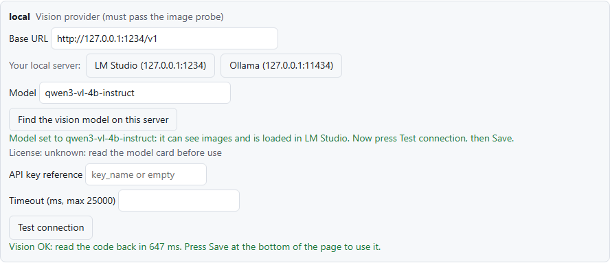
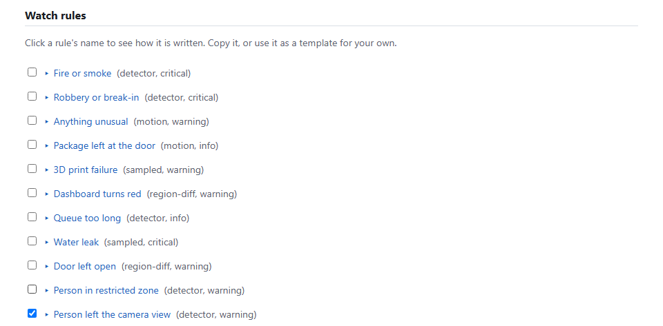
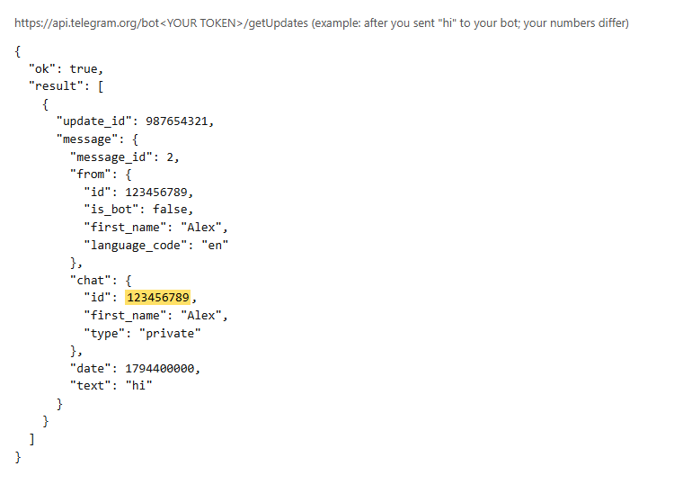
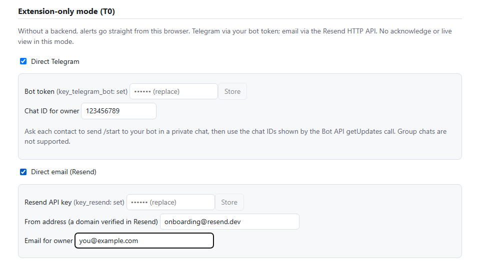
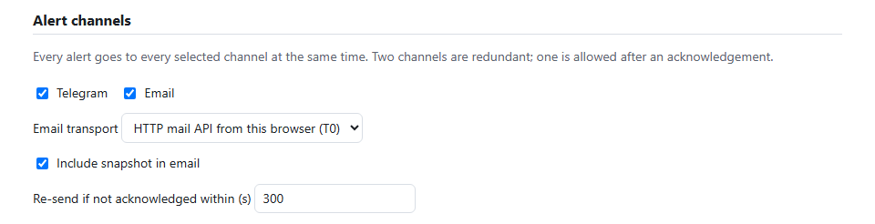
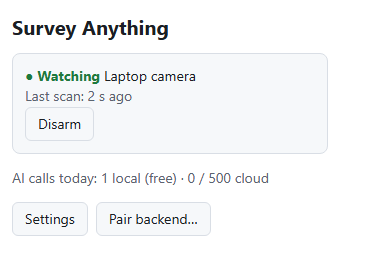

# Beginner guide: a Telegram and email alert when you leave your laptop

This guide sets up one simple job from scratch: your laptop's camera watches you, and when you walk away you
get a Telegram message and an email. While you sit there, nothing happens. Everything here is free: the
AI model runs on your own computer (LM Studio), Telegram bots are free, and Resend has a free email plan.
No server is needed. Allow about 20 minutes the first time.

Contents: [1. Install](#1-install-the-extension) · [2. AI model](#2-a-free-ai-model-on-your-computer-lm-studio) ·
[3. The rule](#3-choose-the-rule) · [4. Telegram](#4-telegram-bot-free) · [5. Email](#5-free-email-with-resend-optional) ·
[6. Start](#6-save-and-start-watching) · [Problems](#if-something-does-not-work)

## What you need

- A computer with a webcam, and Chrome or Chromium 120 or later (Firefox once its review is done).
- Telegram on your phone or computer.
- [LM Studio](https://lmstudio.ai) (free) for the AI check. Optional, but it makes alerts much more reliable.
- A free [Resend](https://resend.com) account, only if you also want email.

## 1. Install the extension

1. Open [Survey Anything on the Chrome Web Store](https://chromewebstore.google.com/detail/survey-anything/pmdlodffhjadcmjipbjhgoggneokieik) and press **Add to Chrome**.
2. A consent page opens. Read it, tick the boxes and press **I agree**. Then press **Allow camera access**
   and accept Chrome's camera prompt (Chrome uses your default camera).
3. Click the puzzle icon in Chrome's toolbar and pin **Survey Anything**, so its icon is always visible.

The settings page is: right-click the extension's icon → **Options**.

**Or build it yourself** (developers, or to run the newest code), with [Node.js](https://nodejs.org) 24 or
later and [Git](https://git-scm.com):

1. Open a terminal (on Windows: PowerShell or Git Bash) and run:

   ```bash
   git clone https://github.com/PacifAIst/survany && cd survany
   corepack enable
   pnpm install
   pnpm build
   ```

   If `corepack enable` asks for administrator rights, use `npx pnpm@10.33.2` in place of `pnpm`.

2. In Chrome open `chrome://extensions`, turn on **Developer mode** (top right), click **Load unpacked** and
   choose the folder `survany/apps/extension/dist`.
   Load this folder itself, not a copy: to update later you run `git pull` and `pnpm build`, then press the
   reload arrow on the extension's card.
3. Continue with the consent page as above.

**Using Firefox (140 or later)?** Build with `pnpm --filter @survey-anything/extension build:firefox`, open
`about:debugging#/runtime/this-firefox`, press **Load Temporary Add-on…** and pick
`apps/extension/dist-firefox/manifest.json`. Every step below is the same. When you start watching, Firefox
opens a pinned **Survey Anything** tab that says "Watching: Camera (…)": Firefox shows it for a moment while the
camera starts, then returns to your tab. Keep it open, and close it to stop.

## 2. A free AI model on your computer (LM Studio)

The extension checks every few seconds, on your computer, whether a person is in view. When it thinks you
left, it asks an AI model to look at the picture and confirm, so a missed detection does not alarm you.
With LM Studio, the picture never leaves your computer.

1. Install LM Studio, search for **qwen3-vl-4b-instruct** in its model search, download it and load it.
   Any model LM Studio marks as able to see images ("vision") works; this one was tested.
2. In LM Studio open the **Developer** tab (its page is titled **Model Server**) and switch the server on.
   It shows **Status: Running** and **Reachable at: http://127.0.0.1:1234**. Nothing else needs changing.
3. In the extension's Options, under **AI providers**: set **Vision provider** to `local`, then in the
   **local** card press **LM Studio (127.0.0.1:1234)**. Chrome asks to let the extension reach `127.0.0.1`:
   allow it. The **Model** fills itself in.
4. Press **Test connection**. Expect **Vision OK**.



No LM Studio? Under **Vision and token savers**, untick **Confirm candidates with AI**. Alerts then come from
the on-device check alone and are labelled *unconfirmed*.

## 3. Choose the rule

Under **Watch rules**, untick everything and tick only **Person left the camera view**.



## 4. Telegram bot (free)

1. In Telegram, search for **@BotFather** (the official one has a blue check mark), open it and press
   **Start**.
2. Send `/newbot`. BotFather asks for a name (anything, for example `My desk alarm`) and then a username that
   ends in `bot` (for example `my_desk_alarm_bot`).
3. BotFather answers with a **token**: a long line like `123456789:ABCdef…`. Copy it and keep it secret:
   anyone with it can send messages as your bot.
4. Open your new bot (BotFather's message has a link `t.me/your_bot`), press **Start**, and then
   **type any message, for example `hi`, and send it**. This step matters: Telegram only shows your chat
   number after you have written to the bot.
5. In your browser, open this address, with your token in place of `<TOKEN>` (no `<` `>`):

   ```
   https://api.telegram.org/bot<TOKEN>/getUpdates
   ```

   You see text like the example below. Your **chat ID** is the number after `"chat": { "id":`
   (highlighted here; yours is different).

   

   - `{"ok":true,"result":[]}`: Telegram has no message yet. Send the bot another message and reload the page.
   - `"error_code":401` (`Unauthorized`) or `"error_code":404` (`Not Found`): the token was not copied
     completely. Copy it again from BotFather.

6. In Options, under **Extension-only mode (T0)**:
   - tick **Direct Telegram**;
   - paste the token into **Bot token** and click anywhere outside the field (or press **Store**). Chrome asks
     to let the extension reach `api.telegram.org`: allow it. The label changes to `key_telegram_bot: set`;
   - type your chat ID into **Chat ID for owner**.

Do not share the token, the getUpdates address or a screenshot of either.

## 5. Free email with Resend (optional)

1. Sign up at [resend.com](https://resend.com) **with the email address where you want the alerts**.
2. In Resend, open **API Keys**, create a key (sending access is enough) and copy it. It starts with `re_`.
3. In Options, under **Extension-only mode (T0)**:
   - tick **Direct email (Resend)**;
   - paste the key into **Resend API key** and click outside the field. Chrome asks to let the extension reach
     `api.resend.com`: allow it;
   - **From address**: `onboarding@resend.dev` (Resend's free test sender, no domain needed);
   - **Email for owner**: the address you signed up to Resend with.

   

4. Under **Alert channels**, tick **Telegram** and **Email**, and set **Email transport** to
   **HTTP mail API from this browser (T0)**.

   

Resend's test sender delivers only to the address of your own Resend account. To email other people,
verify a domain you own in Resend and use an address on that domain as **From address**.

Telegram only, no email? Under **Alert channels**, untick **Email** and press
**I understand, use one channel**.

## 6. Save and start watching

1. Press **Save** at the bottom of the page. It tests the AI model again and shows **Saved at …**.
   **Test connection** alone never saves.
2. Sit in front of the laptop. Click the extension's icon and press **Watch camera**. The popup shows
   **Watching** and the time of the last scan.
3. Walk out of the camera's view and stay away for about 30 seconds. Within about 15 seconds of leaving,
   Telegram (and your email) receives a message like this:

   ```
   ⚠️ Person left the camera view — Camera
   The image shows only curtains and a view of an exterior building, with no human figures present.
   Status: Confirmed by local
   Severity: warning
   Confidence: 98%
   Source: Camera
   Time (UTC): 2026-11-11T10:35:02.543Z
   Event ID: …
   ```

   By default the alert includes a photo from the camera (**Privacy and egress → Alert media**). Untick it if
   you do not want any picture to leave your computer.
4. You get one alert each time you leave. Come back, and the next time you leave you get a new one.
5. To stop, click the icon and press **Disarm**.



**"AI calls today" stays at 0 while you sit there, and that is correct.** The camera is checked every 5
seconds on your computer, for free. The AI is asked only after the camera has seen nobody for about 10
seconds, so one call per time you leave.

## If something does not work

| What you see | What to do |
|---|---|
| "AI calls today: 0" while you are at the laptop | Nothing: that is how it works (see above). Leave the camera's view to test. |
| Test connection: "nothing answered at …" | LM Studio's server is off, or the address is wrong. Start it in the Developer tab and press **LM Studio** again. |
| "LM Studio is running but has no model that can see images" | Download and load a vision model (step 2.1), then press **LM Studio** again. |
| No Telegram message | Check the chat ID (step 4.5), that you sent the bot a message, and that the label says `key_telegram_bot: set`. |
| No email | **From address** must be `onboarding@resend.dev` and **Email for owner** your Resend sign-up address. Look in the spam folder. |
| An alert while you were sitting there | Light from a window behind you can hide you. Turn on a lamp in front of you. The AI check usually stops these. |
| An alert when you covered the camera | Expected: with the camera covered, nobody is visible. |
| "Camera stopped delivering frames", or the camera light stays off | The add-on may be using a virtual camera (NVIDIA Broadcast, OBS…), which shows nothing while its app is closed. From version 0.1.1 (the Firefox add-on, or a build from source): click the extension's icon → **Camera…** → **Choose the camera**, and pick your real webcam. In Chrome 0.1.0, make your real webcam the default in Chrome's camera settings. The pinned tab (Firefox) and the log name the camera in use. |
| Anything else | In Options press F12, open **Console**, paste the line below, and send the output with your issue. |

```js
chrome.runtime.sendMessage({target:'sw',type:'debug-stats'}).then(r=>console.log(r.value.log.slice(-15).join('\n')))
```

Other rules work the same way (fire or smoke, a person in a zone, a door left open, and more). Click a rule's
name in **Watch rules** to see how it is written. For live view on your phone, acknowledgements and
approved device actions, add the backend: `docs/DEPLOY_OME.md`.
